# Antigravity Studio

[简体中文](README.md) · English · [Changelog](CHANGELOG.md)

Antigravity Studio is a desktop account manager and local model proxy for Antigravity App, Antigravity IDE, Antigravity CLI, and the VS Code extension. Manage Google accounts, quotas, and third-party models in one place instead of configuring each client separately.

Accounts, settings, and usage records are stored locally. Model requests still go to Google or your configured provider; this is not an offline tool.

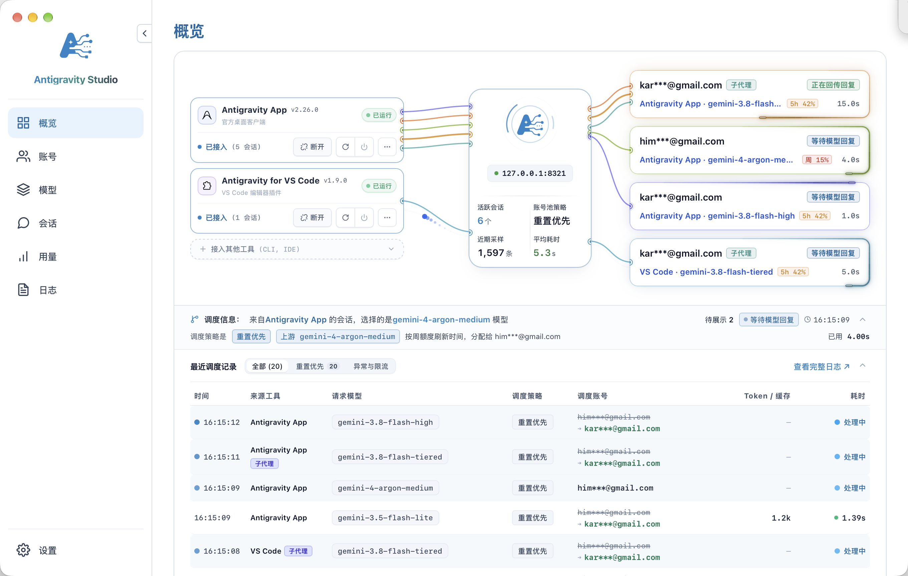

## Key Features

### Accounts and quotas

Add, import, and switch accounts, with a compact account view for checking quotas and status. Argon quota information reflects each account's actual access. Whether it uses a separate quota pool or shares the Gemini pool depends on the quota information returned for that account—not the model name or subscription tier alone.

The account pool offers four scheduling strategies:

- **Failover**: Prefer the primary account and try eligible backup accounts when it is unavailable.
- **Reset First**: Prefer eligible accounts whose quotas reset sooner.
- **Sticky Session**: Keep a session and its subtasks on the same account where possible, reducing unnecessary switches.
- **Load Balancing**: Distribute requests across available accounts by weight.

Set quota thresholds or assign a separate HTTP / SOCKS5 outbound proxy to each account. Scheduling remains subject to model access, available quota, and provider restrictions.

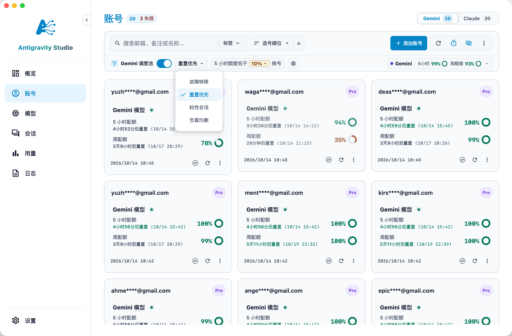
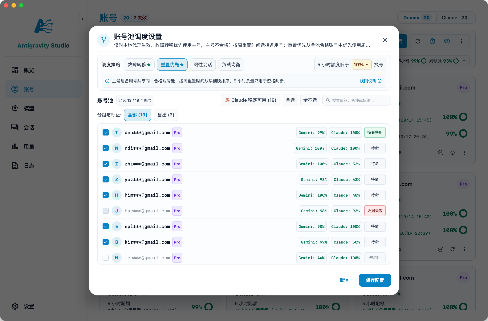
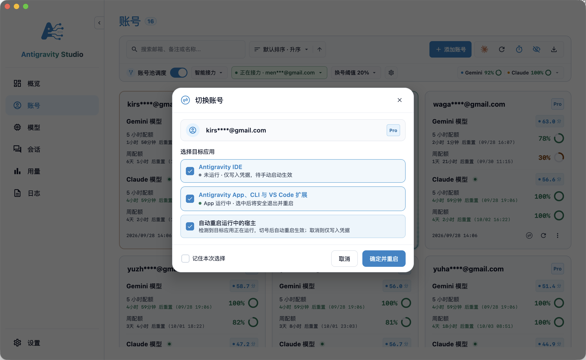

### Bring your own API key

Use provider presets for OpenAI, Anthropic, Gemini, DeepSeek, OpenRouter, and others, or configure a local Ollama instance. Reasoning output, images, and tool calls depend on support from the model and provider.

Connection tests and context settings are available. Increasing a setting cannot exceed the model's actual context limit or guarantee that a long conversation will always be preserved in full.

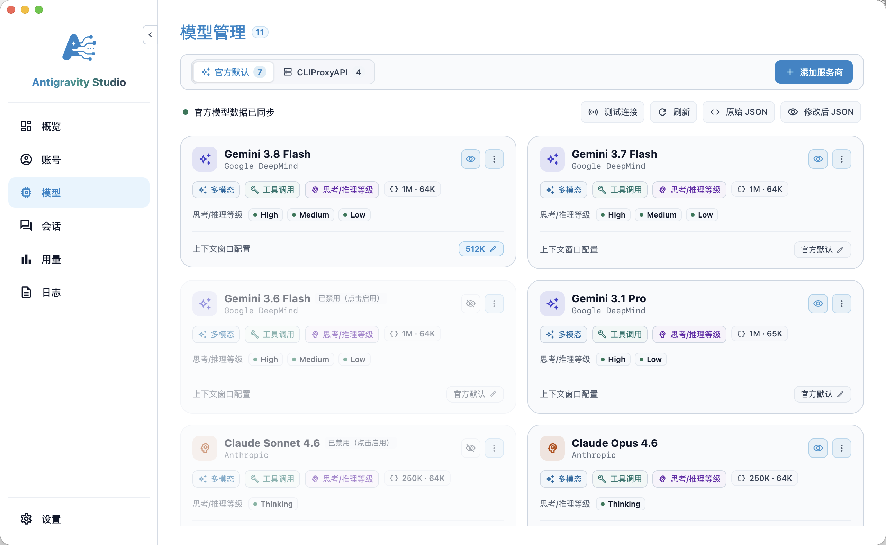
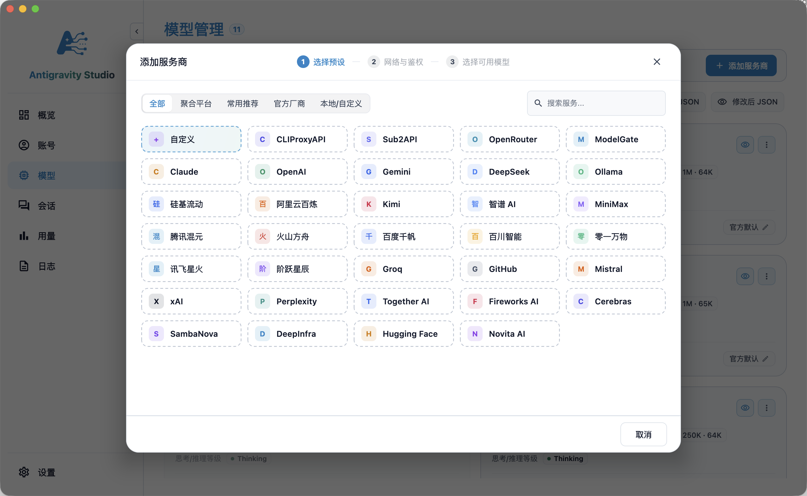

### Client integration and live overview

Enable proxy routing or restore direct connections for the four supported clients; copy a launch command for the CLI. The overview shows request routes, accounts and models in use, in-flight status, and scheduling reasons so you can see where requests are going.

### Sessions and AI titles

Browse history across clients, with filtering and search by project or client. When you generate an AI title, Studio reads conversation content and sends it to your selected model. It does not guarantee that the entire conversation will be read or sent each time. Check that the content is suitable for sharing with that provider before using this feature.

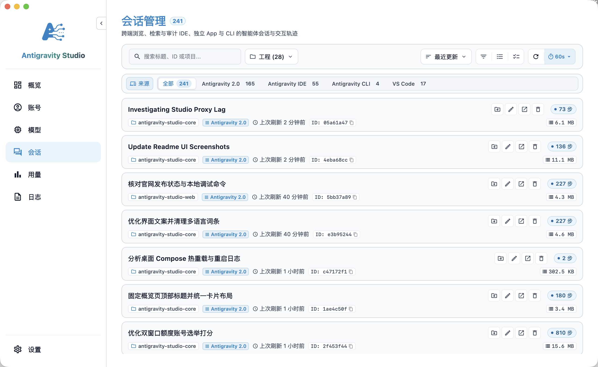
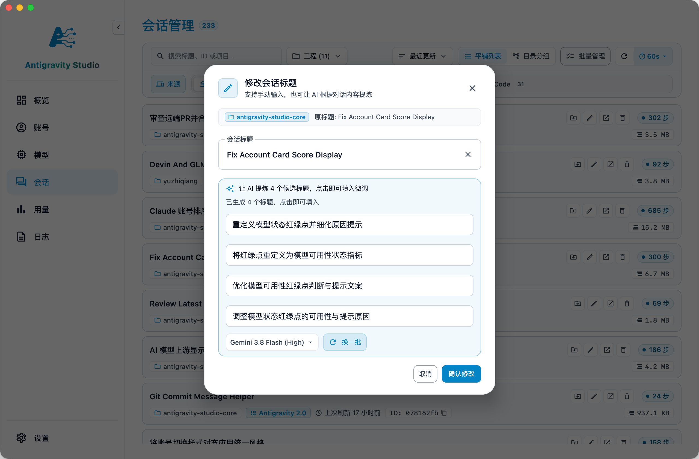

### Usage, model speed comparisons, and network checks

Review request counts, token usage, cost estimates, and request logs. Compare models by time to first token, generation speed, and other metrics. Results vary with network conditions, load, and request content; cost estimates are not provider bills. Network checks help diagnose connection problems.

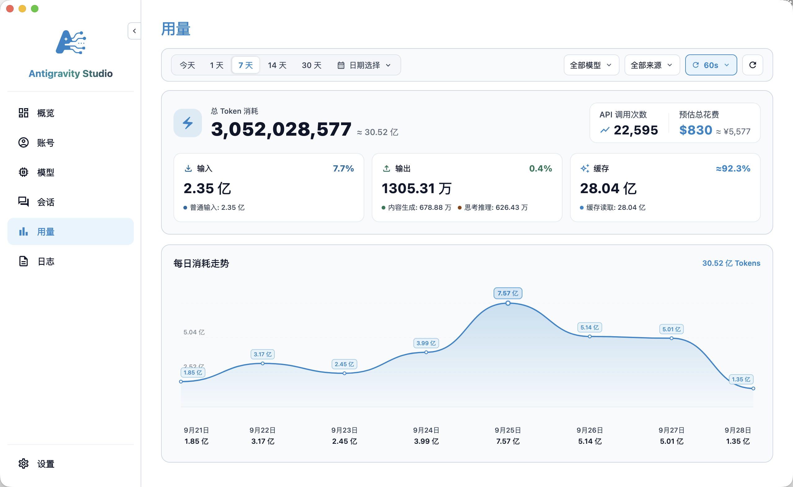
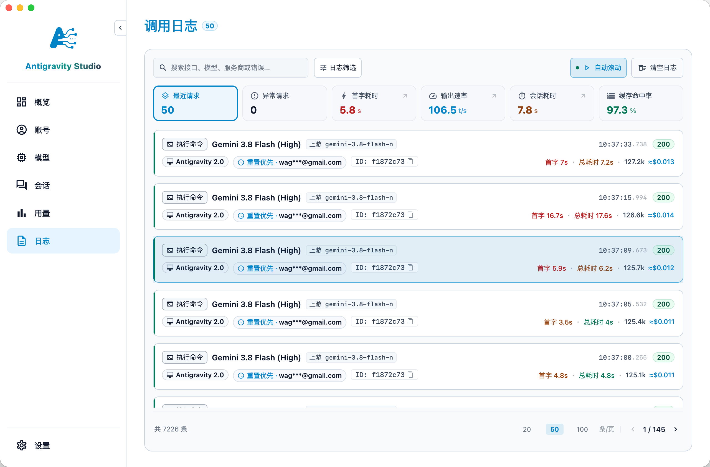
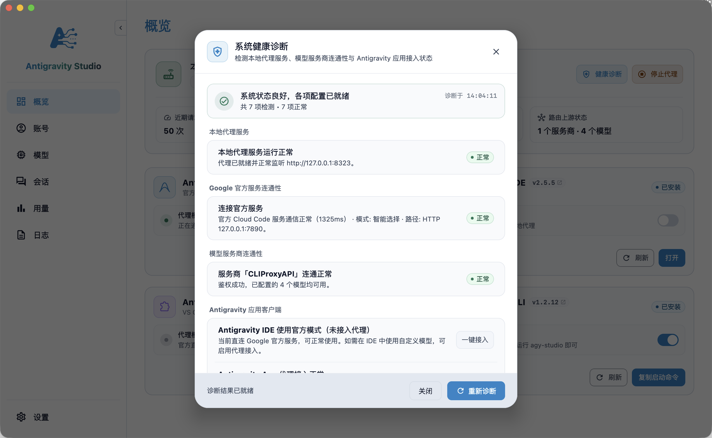

## Installation and Quick Start

### Download and install

Choose a published version from [GitHub Releases](https://github.com/yuzhiqiang1993/antigravity-studio/releases). Replace `<version>` below with that release's version number. Check its release notes for operating system requirements and available installers.

| Platform | Installer |
| :--- | :--- |
| macOS · Apple Silicon | `Antigravity-Studio-<version>-macos-arm64.dmg` |
| macOS · Intel | `Antigravity-Studio-<version>-macos-x64.dmg` |
| Windows · x64 | `Antigravity-Studio-<version>-windows-x64.exe` |

On macOS, open the DMG and move the app to Applications. On Windows, run the installer and make sure the Microsoft Edge WebView2 Runtime is installed. Do not assume compatibility with every Windows 10 environment; check the requirements for your chosen release.

Before upgrading, quit the old version and back up your application data. Do not run old and new versions against the same data at the same time. Closing the window may only hide the app to the tray, so make sure it has fully exited.

### Get started

1. Add Google accounts in **Accounts**, then enable the account pool and choose a strategy if needed. Alternatively, add a provider in **Models**, enter your API key, and enable the models you want.
2. Enable proxy routing for your target client in **Overview**. For the CLI, use the launch command shown in the app.
3. Select a model in your client and send a request. Check the overview and logs to confirm the connection. Save your work before any required client restart.

## FAQ

### What if port 8321 is already in use?

Studio does not switch ports automatically. Choose an available port in settings, then follow the prompts to update the affected client configurations. Clients still pointing to the old port cannot connect to the new address.

### How is automatic scheduling different from switching a client's login account?

Automatic scheduling selects an account for model requests; it does not change the client's login account. Studio may try another account after a rate limit or error, but retries can fail and sessions can be interrupted.

Save your work before switching a client's login account. The operation may restart Antigravity App, the IDE, or the entire VS Code application—not just the current window. The CLI must be restarted manually.

### Why are models missing or requests failing after I enable the proxy?

Check that the model is enabled, the proxy is running, and the client uses the correct port. Then check the account's actual model access, remaining quota, and provider connection. Use network checks and logs to narrow down the problem. If the client needs to reload its configuration, save your work before quitting and restarting it.

### Where is my data stored, and what leaves my computer?

Account credentials, settings, usage records, and logs are stored locally. Model requests and their contents are sent to Google or your configured provider. AI titles also require reading conversation content and submitting it to the selected model. Requests follow your configured outbound proxy or provider endpoint, and data handling also depends on those services' policies. Remove credentials and sensitive content before sharing logs, screenshots, or backups.

### What if macOS says the app is “damaged” or “cannot be opened”?

These warnings can relate to Gatekeeper, signing, or notarization, but they can also indicate an incomplete download, corruption, or tampering. Do not assume the app is simply unsigned. First confirm that the installer came from a trusted release, check any verification information provided with that version, and download it again if needed. Do not bypass the warning if you cannot establish the file's source and integrity.

Only consider the command below after verifying the source and integrity and confirming that the quarantine flag is the cause. It removes the flag from this installed app; it does not repair damaged files. Do not disable system-wide security checks.

```bash
sudo xattr -rd com.apple.quarantine "/Applications/Antigravity Studio.app"
```

### Should I use Studio or Cockpit?

Studio handles desktop account pooling, model proxying, and management across clients. [Antigravity IDE Cockpit](https://open-vsx.org/extension/yuzhiqiang/antigravity-ide-cockpit) focuses on account switching and context usage inside the IDE. Use whichever fits your workflow, or use them together.

## Feedback and Disclaimer

- Bugs and suggestions: [GitHub Issues](https://github.com/yuzhiqiang1993/antigravity-studio/issues). Include the app version, OS version, steps to reproduce, and redacted error details. Do not upload tokens, API keys, or private conversations.
- QQ group: `613214996` for configuration help, questions, and release notices.
- See [MIT License](LICENSE) for license terms. This is an independent third-party project, unaffiliated with Google or Antigravity.

Follow each provider's terms of service. Account pooling and separate proxies do not bypass access rules, quotas, or risk controls. They cannot guarantee protection from account bans, continuous availability, or uninterrupted requests. Provider policies may change; assess the risks and keep backups when using important accounts or data.
