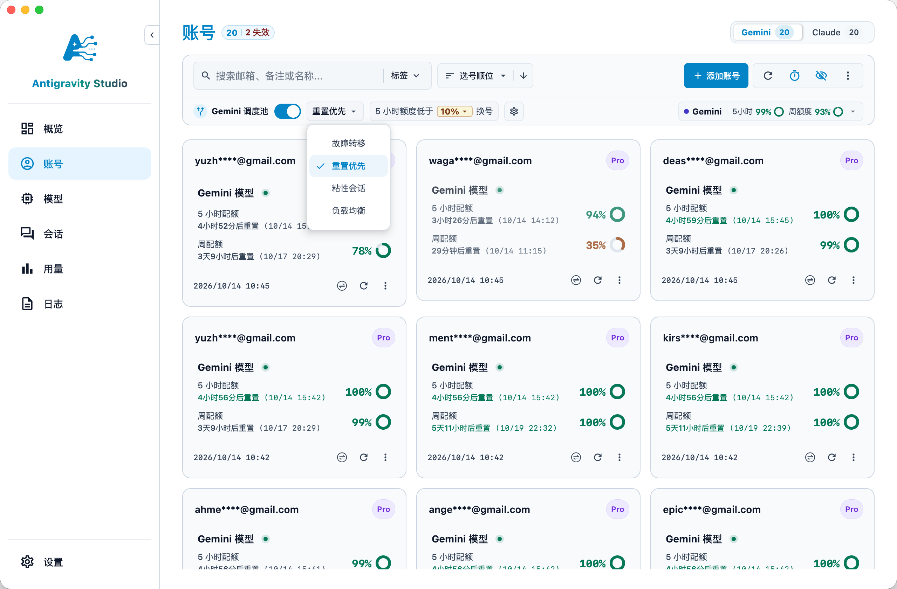
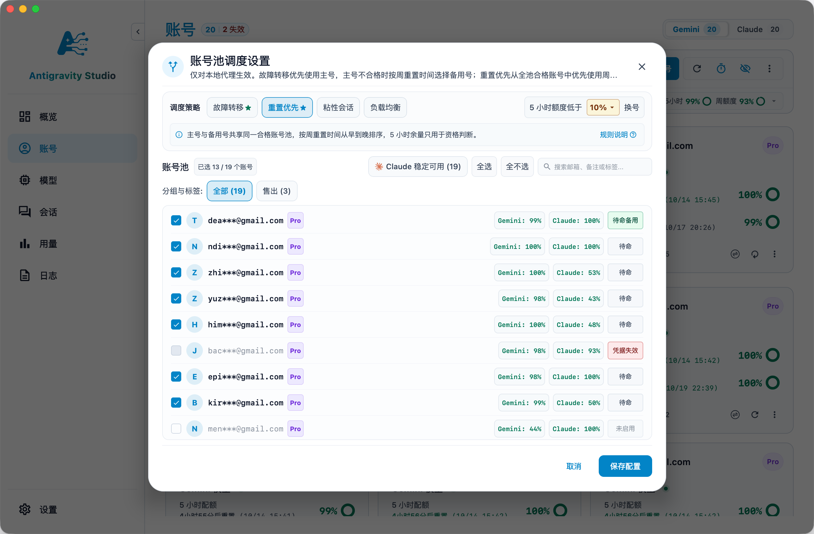
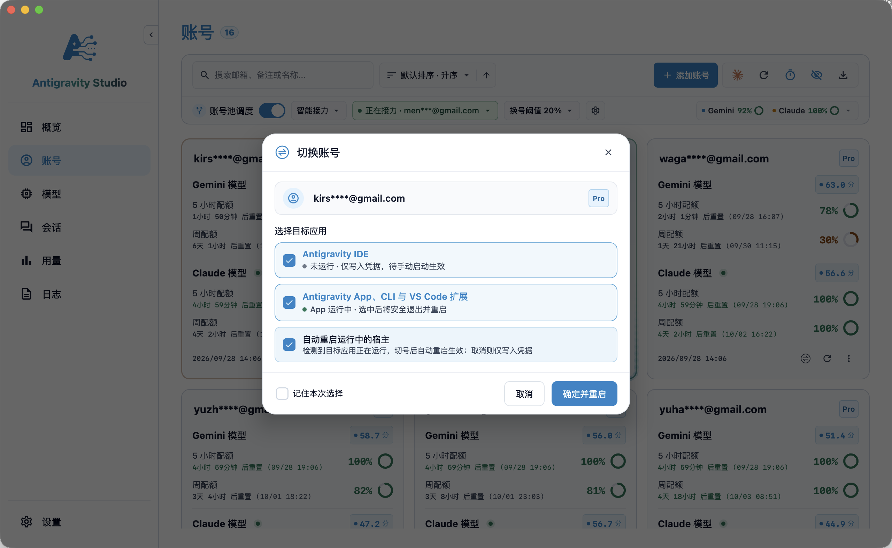
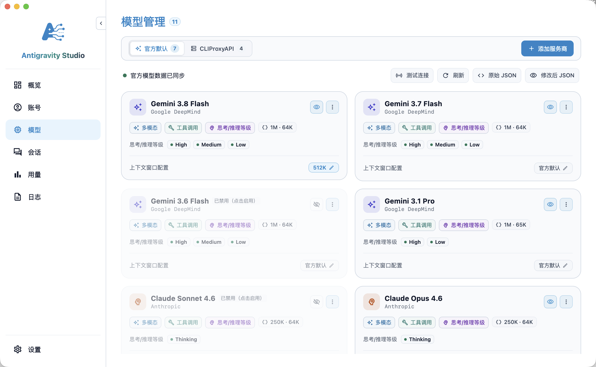
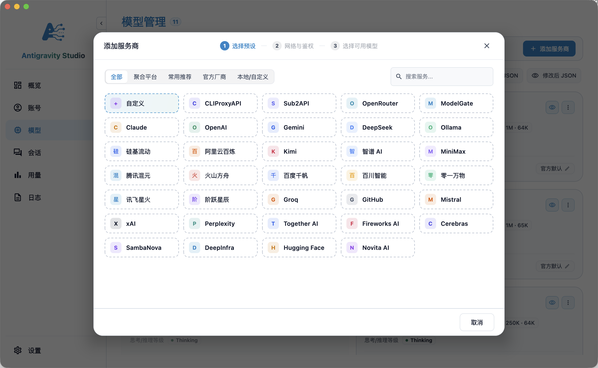
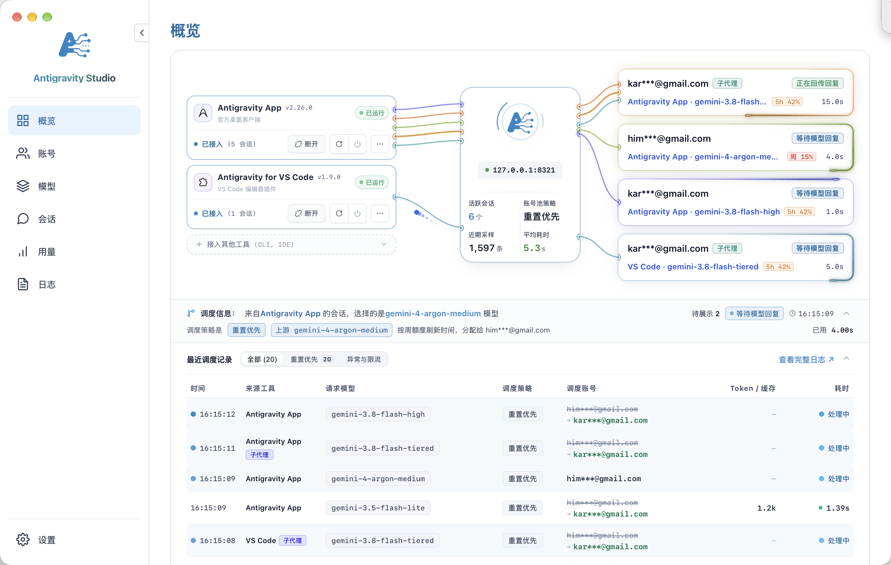
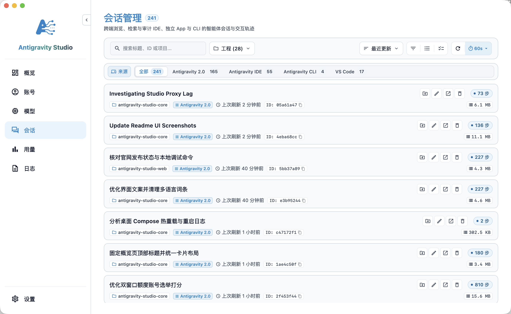
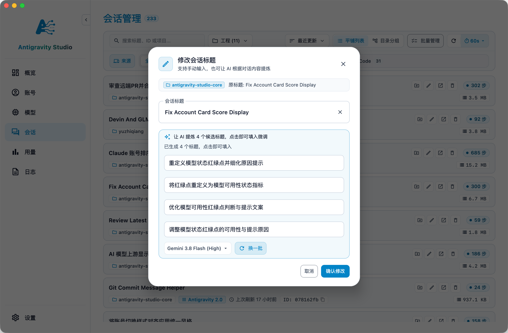
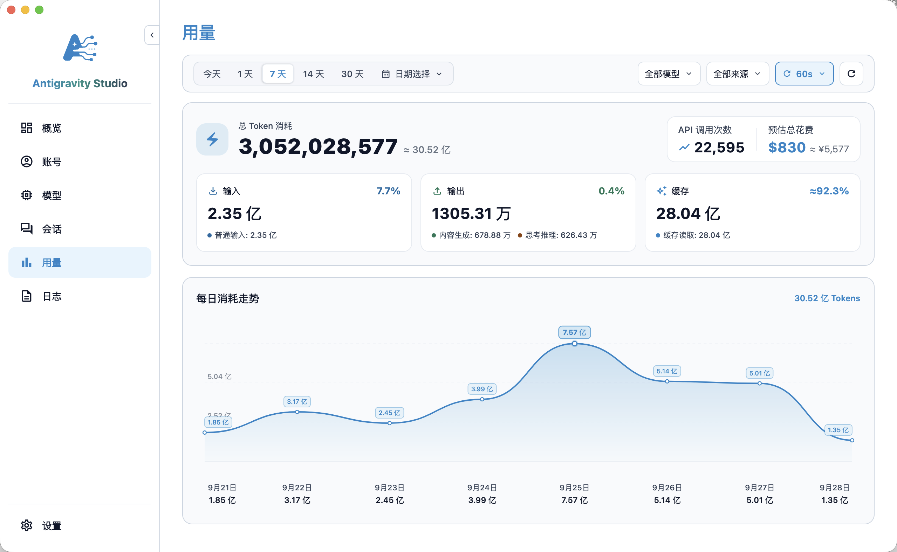
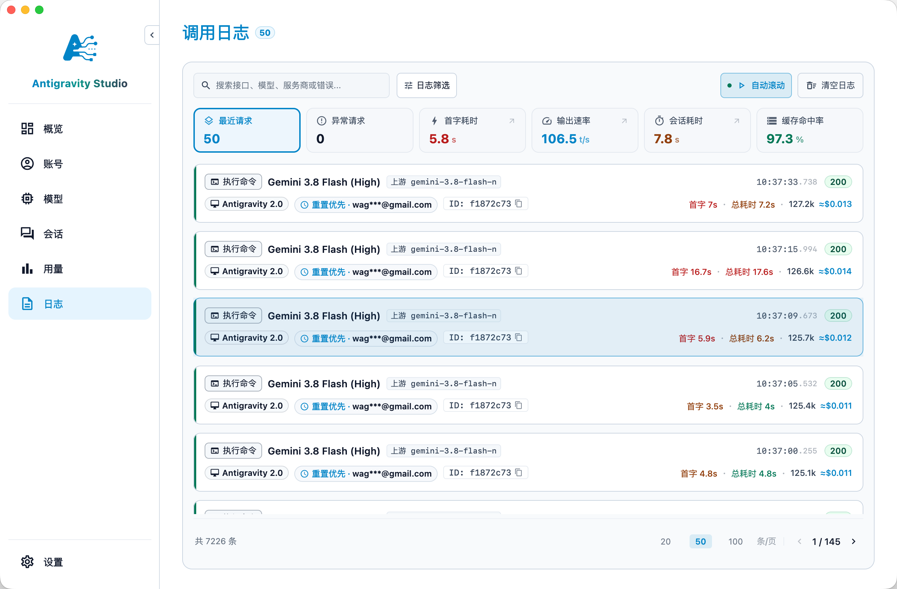

# Antigravity Studio

[简体中文](README.md) · English · [Changelog](CHANGELOG.md)

[](https://github.com/yuzhiqiang1993/antigravity-studio/releases/latest)
[](LICENSE)
[](#feedback-and-community)

Antigravity Studio is a desktop account manager and local model proxy built for **Antigravity App, Antigravity IDE, Antigravity CLI, and the VS Code extension**. Switching Google accounts across clients breaks your flow, a single account hits rate limits quickly during heavy sessions, and bringing in DeepSeek, Claude, or a local Ollama model usually takes extra glue. Studio pulls account pooling, model proxying, and cross-client session management into one local app.

Everything runs locally on your machine with zero telemetry and no third-party relay server. Credentials, settings, session indexes, and usage logs stay on disk; model requests go directly to Google or the providers you configure, so an internet connection is still required for cloud models.

> [!IMPORTANT]
> **macOS says the app is “damaged” or “cannot be opened”?**
> After downloading and verifying the installer from [GitHub Releases](https://github.com/yuzhiqiang1993/antigravity-studio/releases/latest) and moving the app to Applications, open Terminal and clear the quarantine attribute (see [FAQ](#what-if-macos-says-the-app-is-damaged-or-cannot-be-opened) for details):
> ```bash
> sudo xattr -rd com.apple.quarantine "/Applications/Antigravity Studio.app"
> ```

## Demo Video

https://github.com/user-attachments/assets/56421265-6e84-4f2f-b978-e81ce126fbb6

> Walkthrough (`02:18` · Chinese narration): 4-client integration, multi-account failover, per-account proxy & Google quick links, BYOK DeepSeek / Ollama, Composer HUD, cross-client sessions, and local usage.

## Key Features

### Multi-Account Management & Pool Scheduling

Keep multiple Google accounts in one place and track 5-hour and weekly quotas across both the **Gemini** and **Claude** pools in full or compact views. Cards show subscription tiers (Ultra / Pro / Enterprise / Free) and switch to diagnostic cards with appeal or recovery actions when an account hits restrictions. The menu also collects 18 handy official Google links covering region settings, billing, and account security.

When the account pool is enabled, the local gateway routes requests using your chosen strategy:

- **Failover**: Stick to your primary account by default; switch to an eligible backup when quota drops below the threshold or hits rate limits, then return once the primary recovers.
- **Reset First**: Spend accounts whose weekly quota resets sooner, cutting down on unused quota expiring.
- **Sticky Session**: Keep a conversation and its subagents on the same account when possible to preserve server-side prompt cache and avoid unnecessary switches.
- **Load Balancing**: Spread traffic across healthy accounts in the pool by weight.

You can set a custom 5-hour switch threshold and assign an individual HTTP or SOCKS5 outbound proxy per account—token refresh, quota checks, and model calls all follow that account's proxy.



<details>
<summary>More account screenshots (Pool Settings / Client Account Switch)</summary>




</details>

### Bring Your Own API Key (BYOK)

Over 30 built-in provider presets let you wire third-party or local models straight into Antigravity:

- Covers OpenAI, Anthropic, Gemini, Google Vertex AI (API key or service account JSON), DeepSeek, OpenRouter, SiliconFlow, Aliyun DashScope, Volcengine Ark, Kimi, Zhipu, plus local Ollama, LM Studio, and vLLM, or any custom compatible endpoint.
- Includes one-click latency and connectivity checks, per-client official model catalog views, and customizable context window & compaction threshold settings (this adjusts when the client compacts prompts and does not raise a model's real context limit).
- Reasoning output, image inputs, and tool calls adapt automatically based on what the model and provider support.



<details>
<summary>View provider preset list</summary>



</details>

### Four-Client Integration, Live Overview & Composer HUD

- **One-click proxy & direct restore**: Auto-detects Antigravity App, IDE, VS Code extension, and CLI to enable proxying or restore direct connections cleanly. Desktop clients support custom extra launch arguments and run a pre-launch proxy/catalog check; the CLI offers a copy-ready launch command.
- **Live overview & privacy mode**: Displays real-time client-to-account routing lines, active requests, scheduling reasons, actual upstream response models, and the active model catalog. One click in the top bar toggles privacy mode to mask project names, session titles, and emails.
- **Client Composer HUD**: Embeds a compact status bar and hover details right beside the chat input in supported clients—showing the routed account, remaining quota, TTFT, token speed, context usage, common error hints, and one-click prompt optimization.
- **Per-role subagent routing**: Configure subagent routing globally or per role (Official Default / Follow Main Session / Fixed Model) to send search, browsing, or helper tasks to the models that fit best.



### Cross-Client Sessions & AI Titles

Browse conversations from all four clients in one ledger—filter and search by project, client, context usage, or file size, and expand parent-child subagent lineages to compare duration and cost.

When default titles are too vague, rename them manually or generate a few concise candidates using a model you pick. Conversation content is only sent to that model when you explicitly click generate; verify it is appropriate to share with the chosen provider first.



<details>
<summary>View AI title generation screenshot</summary>



</details>

### Local Usage, Activity Logs & Tray Experience

- **Usage & speed comparison**: Track call counts, token breakdowns (input, output, thinking, cache read), and cost estimates over custom date ranges, define custom model pricing rules, and compare TTFT and generation speed across models (cost estimates are for reference and are not provider bills).
- **Activity logs & network check**: Switch between compact table, timeline, and card views, and run Network Check to troubleshoot local proxy, upstream connectivity, or provider setup.
- **Lightweight background mode & verified updates**: Includes a macOS/Windows tray popover and quick menu; enabling Lightweight Mode releases frontend memory and hides the macOS Dock icon when the main window closes. macOS also supports live menu bar metrics. Built-in update checks verify both Ed25519 signatures and SHA-256 checksums before installation.



<details>
<summary>View activity logs screenshot</summary>



</details>

## How It Works

```text
Antigravity Clients (App / IDE / CLI / VS Code Extension)
                       │
                       ▼  Local requests to 127.0.0.1:8321 (loopback-only, configurable)
            Antigravity Studio Local Gateway
                       │
          ┌────────────┴────────────┐
          ▼                         ▼
  Official Model Calls        Custom Model Calls (BYOK)
          │                         │
          ▼                         ▼  Local protocol translation & streaming
 Account Pool Scheduling       OpenAI / Anthropic / Gemini /
 (Failover/Reset/Sticky/LB)    DeepSeek / Vertex AI / Ollama ...
          │
          ▼  Optional per-account HTTP / SOCKS5 proxy
    Google Official API
```

## Download & Quick Start

### Install

Grab the latest build for your platform from [GitHub Releases](https://github.com/yuzhiqiang1993/antigravity-studio/releases/latest) (replace `<version>` with the release version):

| Platform | Installer | Notes |
| :--- | :--- | :--- |
| macOS · Apple Silicon | `Antigravity-Studio-<version>-macos-arm64.dmg` | Open the DMG and drag the app into Applications |
| macOS · Intel | `Antigravity-Studio-<version>-macos-x64.dmg` | Open the DMG and drag the app into Applications |
| Windows · x64 | `Antigravity-Studio-<version>-windows-x64.exe` | Run the installer; requires Microsoft Edge WebView2 Runtime |

Quit the previous version completely before upgrading (closing the window only hides the app to the tray—exit from the tray menu and back up your local app data if needed).

### Get Started in 3 Steps

1. **Add accounts or models**: Sign in or import Google accounts in **Accounts** and turn on the pool if desired, or add a provider preset and API key in **Models** and enable the models you want.
2. **Enable client proxy**: Toggle proxy routing for your target client in **Overview** (or copy the launch command for the CLI).
3. **Send a message**: Pick a model in your client and confirm the route in **Overview** or **Activity**. Save open work before restarting any client if prompted.

## FAQ

### What if port 8321 is already in use?

Studio never silently switches ports behind your back. Pick a free port in **Settings**, then follow the prompt to sync the updated port to your clients—clients still pointed at the old port will fail to connect.

### How is pool scheduling different from switching a client's login account?

Pool scheduling picks an account per model request without changing which account the client is signed into. It may fail over to another eligible account on rate limits or errors, though retries are not guaranteed to succeed without interruption.

Switching a client's login account writes updated local credentials and, if checked, restarts Antigravity App, the IDE, or the entire VS Code instance (the CLI needs a manual restart). Save your work beforehand.

### Why are models missing or requests failing after enabling the proxy?

Check these four items in order:

1. Confirm the target model is enabled in **Models**.
2. Confirm the local proxy is running and the client is connected to the active port in **Overview**.
3. Check the account's actual model access, remaining quota, and provider connectivity test results.
4. Inspect **Network Check** and **Activity** logs, and fully restart the client after saving your work if configuration reload is needed.

### Where is my data stored, and what leaves my computer?

Account credentials, settings, usage records, and logs stay on your local machine with zero telemetry. Only two things leave your computer: model requests sent by your clients (directly to Google or your configured provider through your chosen outbound proxy), and text submitted when you manually trigger AI titles or prompt optimization. Strip tokens, API keys, and private details before sharing logs, screenshots, or backups.

### What if macOS says the app is “damaged” or “cannot be opened”?

This usually happens because the build is not notarized with a commercial Apple Developer certificate, so macOS tags downloaded files with a quarantine attribute—though an incomplete or corrupted download can trigger a similar warning. Confirm the installer came from [GitHub Releases](https://github.com/yuzhiqiang1993/antigravity-studio/releases/latest) and verify its `.sha256` checksum first; once verified, run the `xattr` command at the top of this page to clear quarantine for this app only. Do not disable Gatekeeper globally.

### What if Windows shows SmartScreen warnings or Windows Defender quarantines the app?

Because this is a free personal project without a paid commercial code-signing certificate, Windows may show two kinds of warnings:

1. **Windows SmartScreen ("Windows protected your PC")**: After confirming the installer is from [GitHub Releases](https://github.com/yuzhiqiang1993/antigravity-studio/releases/latest) and matches its checksum, click **More info** → **Run anyway**.
2. **Windows Defender real-time quarantine**: Unsigned Go executables and NSIS installers can trigger Defender machine-learning false positives, and the installer and installed binary may be flagged separately. **Do not globally allow a generic ThreatID**; verify integrity and exclude only the installation directory:
   - Verify the installer against the `.sha256` file published alongside the release (PowerShell):
     ```powershell
     Get-FileHash .\Antigravity-Studio-<version>-windows-x64.exe -Algorithm SHA256
     ```
   - Once verified, open **Windows Security → Virus & threat protection → Manage settings → Exclusions → Add or remove exclusions**, add `%LOCALAPPDATA%\Programs\Antigravity Studio` (and the dedicated folder containing the installer) as folder exclusions, then run the installer again.

### Should I use Studio or Cockpit?

Antigravity Studio focuses on desktop account pooling, third-party model proxying, and unified management across all four clients. [Antigravity IDE Cockpit](https://open-vsx.org/extension/yuzhiqiang/antigravity-ide-cockpit) focuses on lightweight account switching and context usage inside the IDE. Use either one or both together.

## Feedback and Community

- **Issues & suggestions**: Open an issue on [GitHub Issues](https://github.com/yuzhiqiang1993/antigravity-studio/issues) with your app version, OS version, reproduction steps, and redacted errors. Never upload tokens, API keys, or private conversations.
- **QQ group**: `613214996` (setup help, Q&A, and release updates).

## License & Disclaimer

- **License**: See [MIT License](LICENSE).
- **Disclaimer**: This is an independent third-party project unaffiliated with Google or Antigravity. Follow each provider's terms of service. Account pooling and per-account proxies cannot bypass provider access rules, quotas, or risk controls, and do not guarantee protection against bans or uninterrupted service. Assess the risks and back up important accounts and data.
