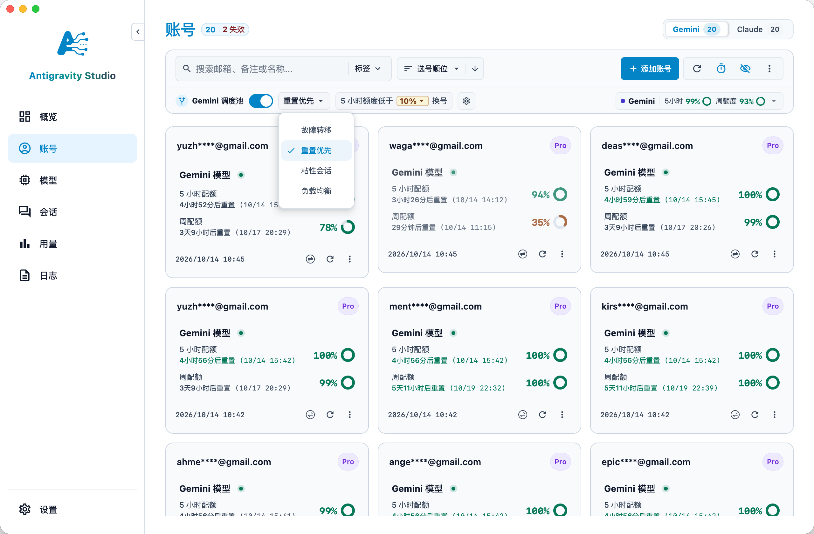
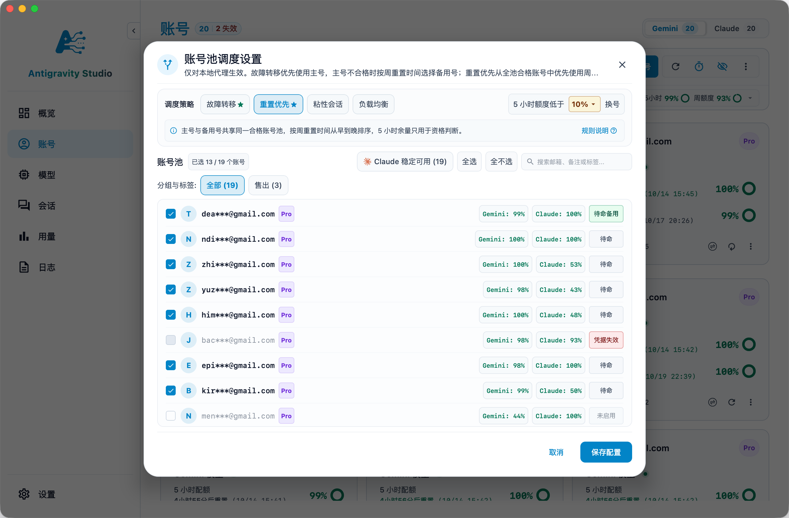
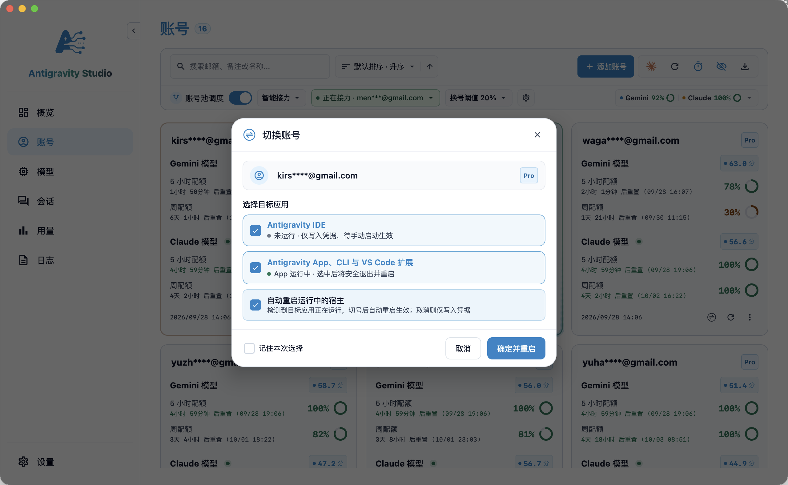
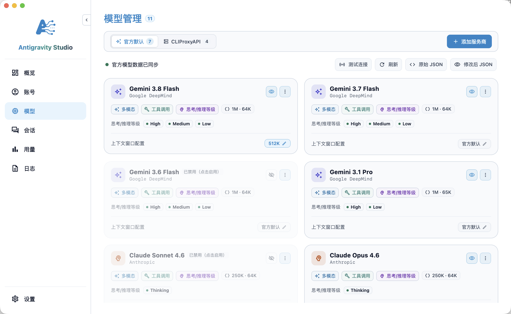
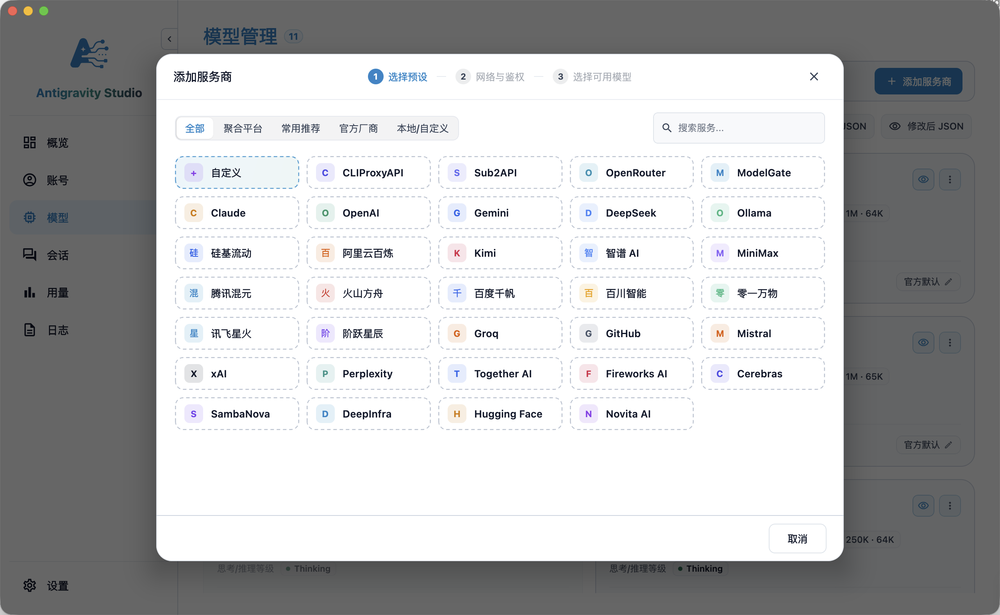
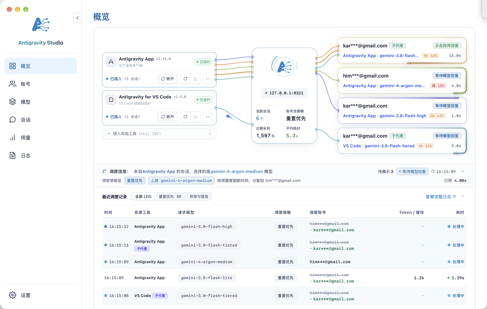
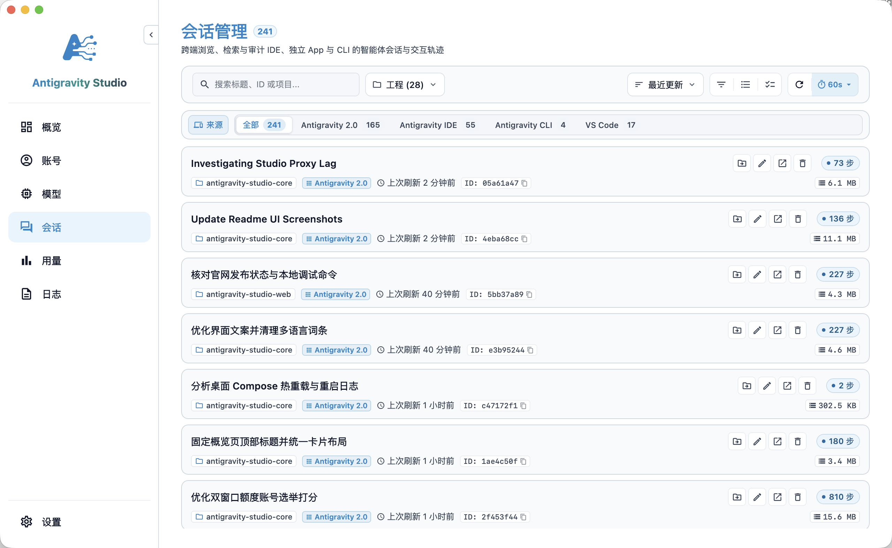
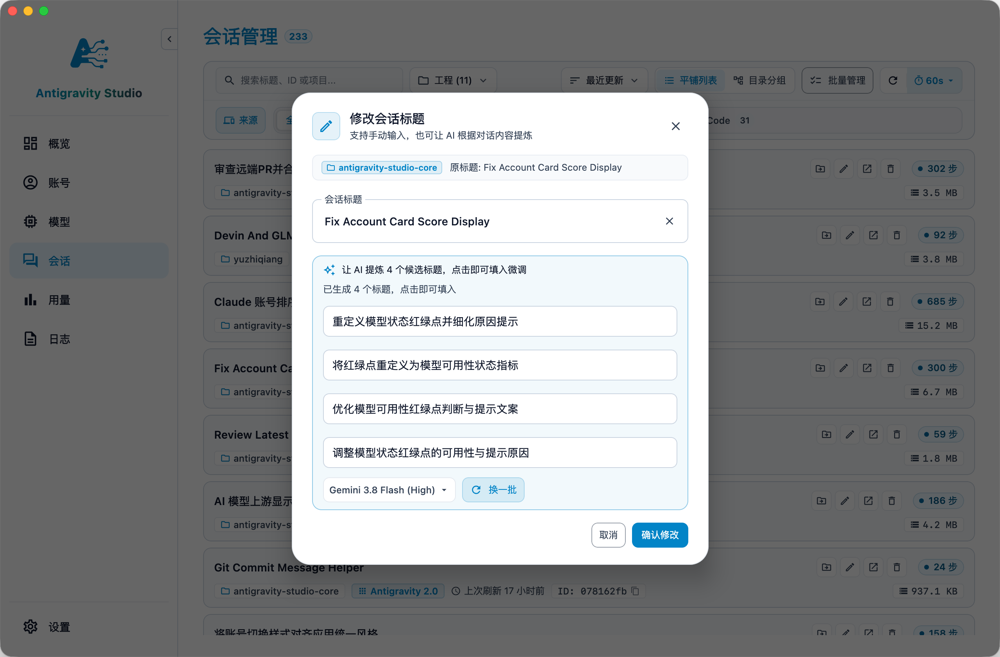
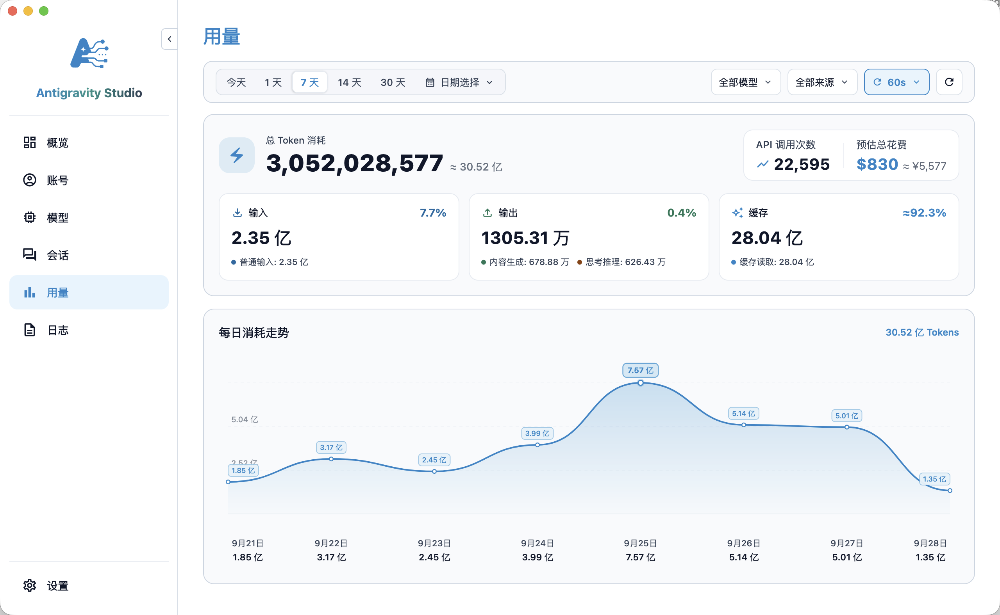
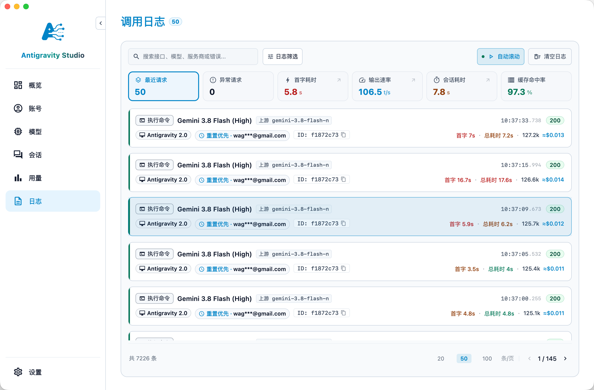

# Antigravity Studio

简体中文 · [English](README.en.md) · [更新日志](CHANGELOG.md)

[](https://github.com/yuzhiqiang1993/antigravity-studio/releases/latest)
[](LICENSE)
[](#反馈与社区)

Antigravity Studio 是一款桌面端多账号管理与本地模型代理工具，适配 **Antigravity App、Antigravity IDE、Antigravity CLI 和 VS Code 插件**。平时用 Antigravity 写代码，多账号来回切很打断节奏，单号高频调用容易撞限流，手里现成的 DeepSeek、Claude 或本地 Ollama 也不好接进来。Studio 把账号池调度、模型代理和跨端会话集中到一个桌面应用里，省去在几个客户端之间反复改配置的麻烦。

软件纯本地运行，无遥测上报，没有开发者中转服务器。账号凭据、配置、会话索引和用量日志都留在你的电脑里；模型请求会直接发往 Google 或你自己配置的模型服务商，不是离线工具。

> [!IMPORTANT]
> **macOS 安装后提示“已损坏”或“无法打开”？**
> 从 [GitHub Releases](https://github.com/yuzhiqiang1993/antigravity-studio/releases/latest) 下载并核对安装包无误、将应用拖入「应用程序」后，打开系统「终端」执行以下命令移除隔离标记即可（原因与安全说明见 [FAQ](#macos-提示已损坏或无法打开怎么办)）：
> ```bash
> sudo xattr -rd com.apple.quarantine "/Applications/Antigravity Studio.app"
> ```

## 功能演示

https://github.com/user-attachments/assets/56421265-6e84-4f2f-b978-e81ce126fbb6

> 演示视频（`02:18` · 中文讲解）：四端接管、多账号自动接力、单号代理与常用链接、BYOK 接入 DeepSeek / Ollama、输入框状态栏、跨端会话与本地用量。

## 核心功能

### 多账号管理与账号池调度

集中管理多个 Google 账号，统一按 **Gemini** 与 **Claude** 双额度池查看 5 小时配额和周配额，提供完整卡片与精简视图。卡片上会标出账号的订阅等级（Ultra / Pro / Enterprise / Free），遇到封禁或异常账号会切换为诊断状态卡，方便定位或申诉；更多菜单里还收纳了福利地区、订阅管理、安全设置等 18 条 Google 常用官方链接。

开启账号池后，本地网关会在后台按所选策略分配请求：

- **故障转移**：默认用主号；主号额度低于阈值或触发限流时自动切到备用号，恢复后再切回来。
- **重置优先**：优先消耗周配额更早重置的合格账号，减少配额到期清零的浪费。
- **粘性会话**：同一对话及其子代理任务尽量留在同一账号，保住服务端上下文缓存，减少不必要的切号。
- **负载均衡**：按权重把请求分摊给池内可用账号。

你可以自定义 5 小时换号阈值，也可以给每个账号单独配置 HTTP 或 SOCKS5 出站代理，刷新 Token、查额度和发请求都会走对应的代理通道。



<details>
<summary>查看更多账号管理截图（账号池设置 / 客户端切号）</summary>




</details>

### 自带 API Key 接入模型（BYOK）

内置 30+ 常见服务商预设，填好 API Key 就能在 Antigravity 里直接调用第三方或本地模型：

- 包括 OpenAI、Anthropic、Gemini、Google Vertex AI（支持 API Key 或服务账号 JSON）、DeepSeek、OpenRouter、硅基流动、阿里云百炼、火山引擎方舟、Kimi、智谱，以及 Ollama、LM Studio、vLLM 等本地服务，也支持自由配置任意兼容接口。
- 支持一键测速与连通性测试、按客户端来源查看官方模型目录，以及自定义上下文窗口和压缩预备线（仅作用于客户端提示压缩时机，不能突破模型真实上下文上限）。
- 思考过程输出、图片与工具调用按对应模型和服务商的实际能力自动适配。



<details>
<summary>查看服务商预设列表截图</summary>



</details>

### 四端接管、运行概览与界面增强

- **一键接管与直连恢复**：自动识别本机已安装的 Antigravity App、IDE、VS Code 插件与 CLI，一键开启代理或恢复官方直连。桌面客户端支持自定义附加启动参数，启动前会先检查代理节点与模型目录状态；CLI 提供复制即用的启动命令。
- **运行概览与隐私模式**：实时展示客户端到账号/模型的路由连线、在途请求、选号原因、上游实际响应模型与当前生效的模型目录。顶栏可一键开启隐私模式，自动脱敏项目名称、会话标题和账号邮箱。
- **客户端界面增强（Composer HUD）**：在支持的客户端对话输入框旁嵌入轻量状态栏与悬浮详情，直接看到当前路由账号、剩余额度、首字与生成速度、上下文占用和常见报错提示，并附带一键提示词优化。
- **子代理分角色路由**：在设置中可为子代理配置全局策略或按角色覆盖（官方默认 / 跟随主会话 / 固定模型），把搜索、浏览等任务分流给更合适的模型。



### 跨端会话整理与 AI 标题

把四个客户端的历史对话汇总到一个列表里，按项目、来源、上下文水位或体积快速筛选搜索，支持展开查看主会话与子代理的父子谱系和开销对比。

遇到默认标题看不清内容时，除了手动改名，也可以点一下让选定模型读取对话内容，提炼几个候选短标题。只有你主动点击生成时，工具才会把对话内容发给对应模型，用之前记得确认内容适合交给该服务商。



<details>
<summary>查看 AI 标题生成截图</summary>



</details>

### 本地用量、调用日志与后台体验

- **用量与速度对比**：按时间范围统计调用次数、Token 拆解（普通输入、内容生成、思考推理、缓存读取）和估算费用，支持自定义模型计费规则，并对比不同模型的首字延迟与生成速度（费用估算仅供参考，不等于服务商实际账单）。
- **调用日志与网络体检**：日志支持精简表格、时间线和卡片三种视图，配合「网络体检」排查本地代理、上游网络和服务商配置问题。
- **轻量常驻与安全更新**：提供 macOS / Windows 系统托盘悬浮窗与快捷菜单；开启「轻量模式」后，关闭窗口会释放前端内存并隐藏 macOS Dock 图标；macOS 还支持在菜单栏显示实时运行指标。内建自动更新检查，下载后强制校验 Ed25519 签名与 SHA-256 摘要。



<details>
<summary>查看调用日志截图</summary>



</details>

## 工作原理

```text
Antigravity 客户端 (App / IDE / CLI / VS Code 插件)
                       │
                       ▼  本地请求发往 127.0.0.1:8321（仅环回监听，端口可改）
            Antigravity Studio 本地网关
                       │
          ┌────────────┴────────────┐
          ▼                         ▼
    官方模型请求                自定义模型请求 (BYOK)
          │                         │
          ▼                         ▼  本地协议转换与流式观测
    账号池调度策略              OpenAI / Anthropic / Gemini /
 (故障转移/重置优先/粘性/均衡)    DeepSeek / Vertex AI / Ollama ...
          │
          ▼  支持单账号独立 HTTP / SOCKS5 代理
     Google 官方服务
```

## 下载与快速上手

### 安装应用

到 [GitHub Releases](https://github.com/yuzhiqiang1993/antigravity-studio/releases/latest) 下载对应平台的最新版本（将 `<version>` 替换为发布版本号）：

| 平台 | 安装包 | 说明 |
| :--- | :--- | :--- |
| macOS · Apple Silicon | `Antigravity-Studio-<version>-macos-arm64.dmg` | 打开 DMG，拖入「应用程序」 |
| macOS · Intel | `Antigravity-Studio-<version>-macos-x64.dmg` | 打开 DMG，拖入「应用程序」 |
| Windows · x64 | `Antigravity-Studio-<version>-windows-x64.exe` | 运行安装程序，需系统已安装 Microsoft Edge WebView2 运行库 |

升级前请先彻底退出旧版，再进行覆盖安装。关闭窗口默认只是隐藏到托盘，建议从托盘菜单退出，必要时先备份本地应用数据。

### 三步开始使用

1. **配置账号或模型**：在「账号」页添加 Google 账号，按需开启账号池并选好策略；或者在「模型」页选择服务商预设、填入 API Key 并启用模型。
2. **开启客户端代理**：在「概览」页为要用的客户端打开代理开关；使用 CLI 时复制界面给出的启动命令即可。
3. **发起对话并确认状态**：在客户端选择模型开始对话，去「概览」或「日志」确认请求已正常走通。如果界面提示重启客户端，记得先保存手头改动。

## 常见问题

### 默认端口 8321 被占用怎么办？

Studio 不会在后台偷偷换端口，以免把已有客户端配置搅乱。去「设置」里改成一个空闲端口，再按界面提示同步更新各个客户端的代理配置就行；还指向旧端口的客户端连不上新地址。

### 自动调度和「切换客户端登录账号」有什么区别？

账号池调度只在模型请求发出去时帮你选号，不会改客户端里当前登录的账号。遇到限流或异常时会尝试切换池内其他合格账号，但不能保证每次重试都成功或会话完全不中断。

手动「切换客户端登录账号」则会更新客户端本地凭据，并按你的勾选重启 Antigravity App、IDE 或整个 VS Code（CLI 需手动重启），操作前记得先保存代码。

### 开了代理，为什么看不到模型或请求失败？

按顺序排查这几项通常就能定位：

1. 在「模型」页确认目标模型已经启用；
2. 在「概览」页确认本地代理正在运行，且目标客户端已接入当前端口；
3. 检查账号实际拥有的模型权限、剩余配额，以及第三方服务商的连通性测试结果；
4. 用「网络体检」和「日志」看具体报错，必要时保存工作后彻底重启一次客户端。

### 数据存在哪里？哪些内容会离开电脑？

账号凭据、配置、用量统计和调用日志都保存在本机目录中，没有任何遥测上报。只有两类数据会发往外部：一是客户端发出的模型请求（直发 Google 或你配置的服务商，遵循对应的出站代理设置）；二是你主动点击 AI 标题生成或提示词优化时，对应文本会发给你选定的模型。分享日志、截图或备份前，请先去掉 Token、API Key 等敏感信息。

### macOS 提示“已损坏”或“无法打开”怎么办？

这类提示通常是因为安装包尚未经过苹果开发者公证，系统给下载文件加了隔离标记（quarantine），但也可能是下载不完整或文件损坏。请先确认安装包来自本仓库 [GitHub Releases](https://github.com/yuzhiqiang1993/antigravity-studio/releases/latest) 并核对随附的 `.sha256` 校验值；确认来源与完整性没问题后，再执行文首的 `xattr` 命令仅对该应用解除隔离。不要为了省事去全局关闭 macOS Gatekeeper。

### Windows 提示 SmartScreen 拦截或 Windows Defender 误报隔离怎么办？

由于本项目为个人免费工具，暂未购买商业代码签名证书，Windows 可能会触发以下两类提示：

1. **蓝色 SmartScreen 提示（“Windows 已保护你的电脑”）**：确认安装包来自本仓库 [GitHub Releases](https://github.com/yuzhiqiang1993/antigravity-studio/releases/latest) 且校验无误后，点击「更多信息」→「仍要运行」即可继续安装。
2. **Windows Defender 实时保护误报并直接隔离**：未签名的 Go 桌面程序与 NSIS 安装包容易触发 Defender 机器学习启发式误报，且安装包与安装后的主程序可能分别触发拦截。**请勿按 ThreatID 全局放行某类威胁**，建议核验完整性后仅排除安装目录：
   - 先核对 Release 随附的 `.sha256` 校验文件（PowerShell）：
     ```powershell
     Get-FileHash .\Antigravity-Studio-<version>-windows-x64.exe -Algorithm SHA256
     ```
   - 确认哈希与官方 Release 一致后，打开 **Windows 安全中心 → 病毒和威胁防护 → 管理设置 → 排除项 → 添加或删除排除项**，将安装目录 `%LOCALAPPDATA%\Programs\Antigravity Studio`（以及存放安装包的专用下载目录）添加为文件夹排除项，再重新安装。

### Studio 和 Cockpit 怎么选？

Antigravity Studio 侧重桌面端的账号池调度、第三方模型代理以及四个客户端的统一管理；[Antigravity IDE Cockpit](https://open-vsx.org/extension/yuzhiqiang/antigravity-ide-cockpit) 侧重 IDE 内部的轻量切号和上下文用量查看。看自己需要单用，也可以配合着一起用。

## 反馈与社区

- **问题与建议**：欢迎到 [GitHub Issues](https://github.com/yuzhiqiang1993/antigravity-studio/issues) 反馈。提 Bug 时请附上应用版本、系统版本、复现步骤和脱敏后的报错信息，不要上传 Token、API Key 或私人会话内容。
- **QQ 交流群**：`613214996`（日常答疑、配置交流与新版本通知）。

## 许可与免责声明

- **许可条款**：详见 [MIT License](LICENSE)。
- **免责声明**：本项目是独立第三方工具，与 Google 或 Antigravity 官方无任何关联。使用过程中请遵守各服务商的使用条款；多账号调度与独立出站代理无法绕过服务商的权限、配额或风控策略，也不承诺防封号、持续可用或请求不中断。涉及重要账号和数据时，请自行评估风险并做好备份。
